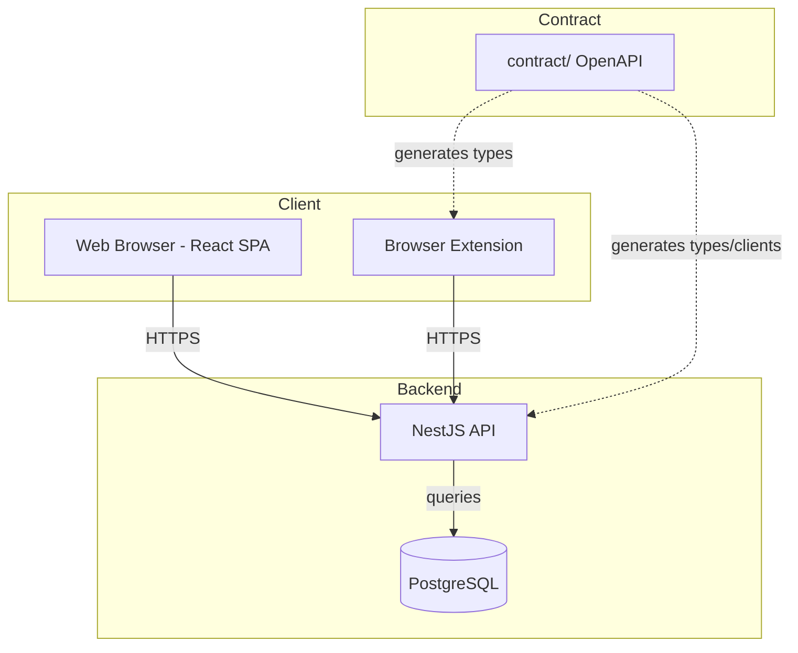
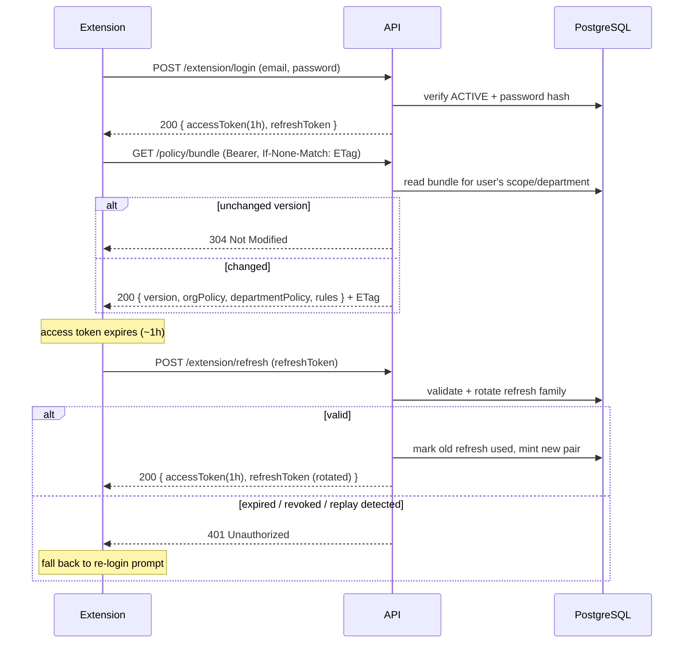
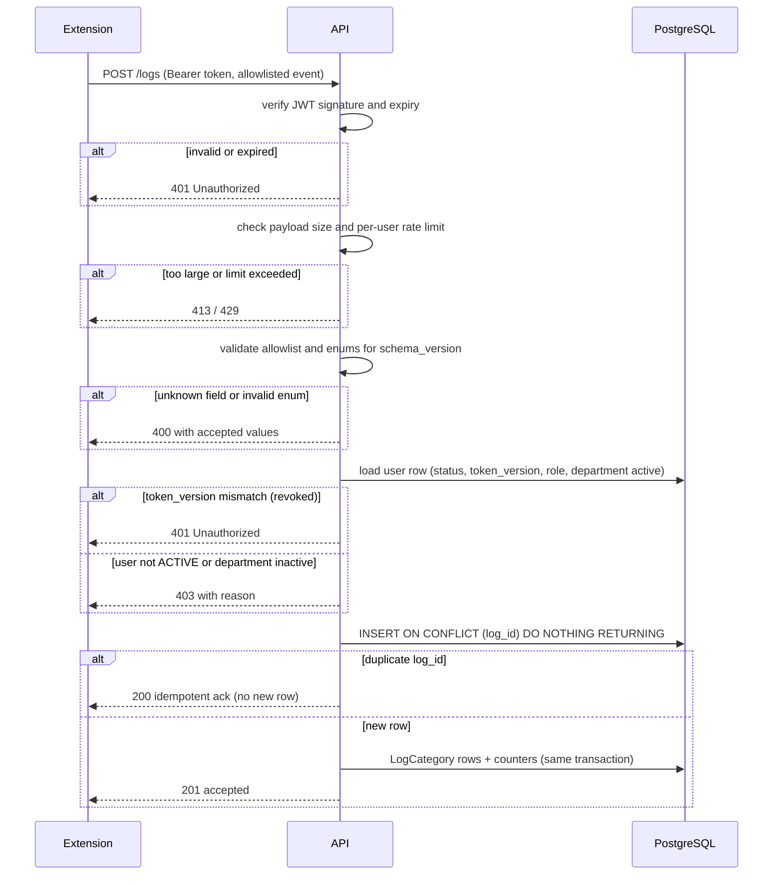
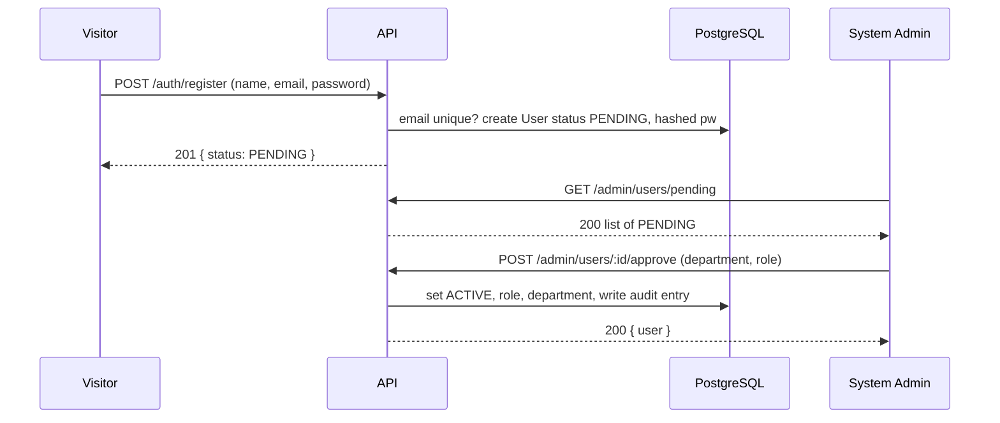
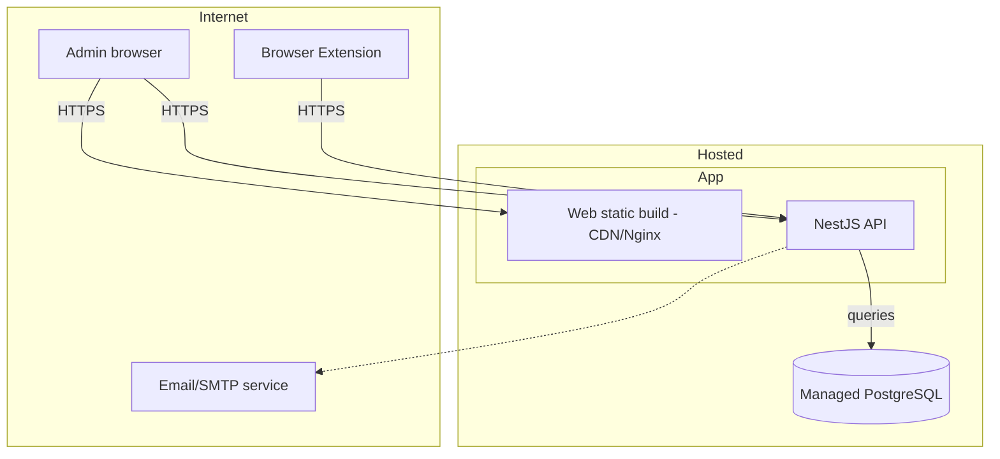

# Hares AI Web — Architecture

Web (dashboards + public pages) and backend API for Hares AI. Source of truth: `docs/DECISIONS.md`; requirements from `docs/SPEC-WEB.md`. Scope of this document: web + API. The browser extension is built separately; the API contract is the bridge. Fixed stack (not negotiable): TypeScript · React (Vite) · NestJS · PostgreSQL · monorepo `web/`, `api/`, `contract/`. Simple, well-known choices; no microservices.

---

## 1. Drivers

1. **Metadata-only privacy boundary** — the backend never receives, stores, or returns prompt text (original, masked, or revised) or any placeholder value. *(DECISIONS #2; WEB-NFR-002, WEB-NFR-011; WEB-FR-046)*
2. **Three-role RBAC with an explicit capability matrix** enforced server-side on every privileged endpoint/screen, including the explicit denials. *(WEB-FR-018, WEB-FR-012, WEB-NFR-003)*
3. **Extension-facing contract** — versioned policy bundles plus idempotent, strict-allowlist log ingestion that derives identity from the token. *(WEB-FR-042, WEB-FR-045–049; WEB-NFR-005, WEB-NFR-021)*
4. **Immediate account/token-state enforcement** — deactivation, rejection, or password change invalidate outstanding tokens at once. *(WEB-FR-059, WEB-FR-014, WEB-FR-015; DECISIONS #12)*
5. **Bilingual, RTL, DGA-aligned, accessible, near-real-time UI with bounded retention** — Arabic/English parity + RTL, WCAG 2.1 AA, mobile-first, ≤30 s dashboard lag, 90-day log purge while keeping aggregates. *(WEB-NFR-007, NFR-010, NFR-012–NFR-015; WEB-FR-067)*

---

## 2. Technology choices

| Concern | Options considered | Choice | Reason |
|---|---|---|---|
| ORM / query layer | Prisma, TypeORM, Drizzle, Knex | **Prisma** | Schema-first, generated typed client, safe-by-default queries, SQL migrations, seed support; lowest friction for a small team. |
| Web UI auth | Session cookie, JWT access+refresh | **JWT access (15 min) + HTTP-only refresh cookie (30-day, rotated)** | Stateless SPA access; refresh in an HTTP-only `SameSite`+`Secure` cookie avoids XSS token theft; short TTL keeps role/status changes effective quickly; carries `token_version` for revocation. *(WEB-FR-003/005/006; DECISIONS #12)* |
| Extension auth | Opaque token, JWT, API-key | **JWT access (≤1 h) + rotating refresh token in extension storage** | Extensions can't use cookies; no stored password; server-side revocable via `token_version`/refresh family. *(WEB-FR-043, WEB-FR-059; DECISIONS #12)* |
| Validation library | class-validator, Joi, Zod | **Zod** | One TS schema yields runtime validation *and* inferred types; composable for the strict allowlist + enum version gating. |
| UI component library | Ant Design, MUI, DGA Platform Code, shadcn/Radix+Tailwind | **shadcn/ui + Radix + Tailwind** (pending DGA evaluation) | Full control of DGA design tokens and RTL via logical CSS; accessible defaults. Evaluate **DGA Platform Code** first; fallback = map DGA tokens onto shadcn. *(WEB-NFR-012/013/015)* |
| Chart library | Recharts, Chart.js, ECharts | **ECharts (thin wrapper)** — Arabic/RTL support **UNVERIFIED** | Rich chart types for dashboards; RTL/Arabic rendering needs a **spike** before commit. *(WEB-FR-028–031)* |
| i18n | react-i18next, FormatJS, custom | **react-i18next** | Lazy JSON catalogs, ICU, `dir`/RTL handling, persisted language switcher on every page. *(WEB-NFR-012)* |
| Testing | Vitest, Jest | **Backend: Jest + Supertest · Frontend: Vitest + RTL · E2E: Playwright** | NestJS defaults to Jest/Supertest; Vite pairs with Vitest; Playwright covers cross-browser + RTL/a11y E2E. |
| Migrations | Prisma Migrate, node-pg-migrate, TypeORM | **Prisma Migrate** | Schema-first, generated SQL, seeds the bootstrap System Admin. *(WEB-FR-008)* |
| Containerization | docker-compose, K8s, none | **Docker + docker-compose (Postgres + api + web)** | Single-command local parity for a small team; managed Postgres at deploy. Not microservices. |

**OpenAPI contract (F5).** Hybrid. **Contract-first for the extension-facing endpoints** (`login`, `refresh`, `policy bundle`, `log ingestion`) because the extension is built in parallel and must not wait on the server — those schemas are authored in `contract/openapi.yaml` and both the API and the extension generate types from it. **Code-first (`@nestjs/swagger`) for web-internal endpoints**, where the NestJS code is the source of truth and the generated OpenAPI is emitted into `contract/`. **`contract/` layout:** `contract/openapi.yaml` (hand-written extension contract + ingestion schema), `contract/src/` (generated TS client types for web and extension), and generated web-schema emitted as `contract/web.openapi.json`. The ingestion **allowlist and enum/schema_version gating** are defined once in the contract and imported by the API. *(DECISIONS #2, #8, #21; WEB-FR-046–049, WEB-NFR-005/021.)* **Assumption:** part-2 implementation will finalize the exact generation pipeline.

---

## 3. Backend modules (NestJS)

- **AuthModule** — register, login, logout, refresh (web + extension), forgot/reset password (single-use link, 30-min, rate-limited), extension login; password hashing (WEB-NFR-004), throttling (WEB-NFR-020), token issuance/`token_version` revocation, refresh rotation + reuse detection. *WEB-FR-001–008, 043, 059, 062; DECISIONS #3/#12/#15/#22.*
- **UsersModule** — admin user lifecycle: pending approvals, approve (dept+role, SYSTEM_ADMIN excluded), reject, reactivate, deactivate, change department, assign role, grant/revoke SYSTEM_ADMIN; profile view, change own password; enforces no-self-deactivate/demote and Dept-Admin-can't-touch-admins. *WEB-FR-009–017, 053, 057–058, 060–063; WEB-NFR-019.*
- **DepartmentsModule** — list with member counts, create, rename, deactivate; deactivation also blocks ingestion. *WEB-FR-019, 054–056, 064; DECISIONS #18/#23.*
- **PolicyModule** — org default + per-department policy, custom rules (PATTERN/KEYWORD/TOPIC) with regex length + ReDoS validation, TOPIC warning, versioned bundle build + ETag, extension bundle endpoint. *WEB-FR-034–042, 044, 065; WEB-NFR-006/017; DECISIONS #5/#6/#7.*
- **IngestionModule** — extension log ingestion: strict allowlist, enum + `schema_version` gating, identity derived from token, idempotency by `log_id`, reject for deactivated user/department. *WEB-FR-020, 045–049, 056, 059; WEB-NFR-002/005/008/011/021.*
- **LogsModule** — scoped log review + filters (date/user/risk/category/platform/user_decision), blocked-messages subset, CSV export (streamed). *WEB-FR-021–027, 031–032, 066.*
- **AnalyticsModule** — role-scoped dashboard aggregates and the counter-reconcile job. *WEB-FR-028–033; WEB-NFR-007/010.*
- **AuditModule** — append-only admin audit trail: record + query; no update/delete path. *WEB-FR-050–052; DECISIONS #11/#19.*
- **RetentionModule** — scheduled purge of `ActivityLog` older than 90 days, preserving counters; never touches audit trail. *WEB-FR-067; DECISIONS #11.*
- **SeedModule** — idempotent bootstrap of exactly one initial System Admin. *WEB-FR-008; DECISIONS #3.*
- **CommonModule** — JWT guard, roles/RBAC guard, extension guard, validation pipe, error-format filter, redacting logging interceptor (`requestId`), config, correlation ID.

**Scheduled jobs (F6).** Retention purge (**@nestjs/schedule** everyday cron) and counter reconcile/backfill run inside Analytics/Retention modules. **Assumption:** a single API instance per organization (matches simple/no-microservices), so jobs run on that instance; if replicated, take a **PostgreSQL advisory lock** (`pg_advisory_lock`) or a lock row so exactly one instance executes the job at a time. *(WEB-NFR-010/011, WEB-FR-067.)*

---

## 4. Cross-cutting design

**RBAC enforcement.** A global `JwtAuthGuard` authenticates; a `RolesGuard` evaluates a `@Roles(...)`/capability decorator against the token's role and returns 403 for the matrix's explicit denials (`✗`). Role checks are layered at the **route (guard)** and the **service layer** for the hard rules. Scope is enforced where the matrix demands: Department Admin queries filter `department_id = token.department`; self-protection (no deactivating/demoting self, WEB-FR-061) and Dept-Admin-cannot-touch-admins (WEB-FR-063) are service-level. Extension endpoints are guarded by a dedicated `ExtensionGuard` requiring `client_type=extension`; web tokens cannot call extension endpoints and vice versa (an admin cannot ingest logs). *(WEB-FR-012/018/061/063; WEB-NFR-003; DECISIONS #14/#17.)*

**Identity derivation on ingestion.** The ingestion request carries **no** `user_id` or `department_id`. `user_id` is read from the token `sub`; `department_id` is resolved from the **current** user record at ingest time and snapshotted onto the log (so a department change is reflected and a deactivated department/user is rejected, WEB-FR-056). Any client-supplied identity field is rejected as non-allowlisted. *(Assumption: department snapshotted from the live user record rather than a token claim.)* *(WEB-FR-048; DECISIONS #2/#8/#21.)*

**Strict allowlist validation.** A Zod `.strict()` schema built only from the Section-6 allowlist rejects any unknown field (400) — including any prompt-text-named field — and stores nothing on failure. Enum values are validated against the set allowed by the incoming `schema_version`; unknown values are rejected with an actionable error listing accepted values (never silently dropped, WEB-NFR-021). A test posts a prompt-text field and expects rejection (WEB-NFR-002). *(WEB-FR-046, WEB-FR-049; WEB-NFR-005/011/021; DECISIONS #2.)*

**Idempotent ingestion by `log_id`.** Unique index on `ActivityLog.log_id`. Insert uses `INSERT ... ON CONFLICT (log_id) DO NOTHING RETURNING`. If a row is returned, the event was newly created; if none is returned, it is a duplicate → return the prior acknowledgement (idempotent success). Only a newly-created row increments counters. *(Assumption: duplicate `log_id` returns success and ignores the new payload rather than rejecting a mismatch.)* *(WEB-FR-047; DECISIONS #8.)*

**Audit logging.** `AdminAuditLog` rows are append-only: acting admin id, action enum, target, timestamp, non-sensitive detail; written in the **same transaction** as the admin action. No update/delete write path plus a DB-level guard/trigger prevents mutation (WEB-FR-052). Never contains prompt text. *(WEB-FR-050–052; DECISIONS #11/#19.)*

**Login throttling.** Progressive delay **per account and per source address**, no hard lockout, no System-Admin reset. After 5 consecutive failures within 15 min, each further attempt doubles the delay (capped at 15 min); successful login or password reset clears the counter; the response never reveals whether the email exists. A persisted failure counter (per account + per IP) lives across restarts; `@nestjs/throttler` enforces the per-endpoint window; extension login is throttled independently. *(DECISIONS #22; WEB-NFR-020, WEB-FR-007.)*

**CSV export (F1).** Admin-only, department-scoped (WEB-FR-025; DECISIONS #16). Prisma has no native streaming, so export uses **keyset pagination in chunks**: order by the stable tuple `(event_time DESC, log_id DESC)`, fetch in batches (e.g., 1000 rows) using a cursor (`where (event_time, log_id) < (lastEventTime, lastLogId)`), and write each batch to the response stream until exhausted — an index-friendly, memory-bounded cursor. Only allowed metadata columns are emitted, never prompt text. Formula-injection safety: any cell starting with `=`, `+`, `-`, `@`, tab, or CR is prefixed (treated as text) then CSV-quoted. *(WEB-FR-025/026; WEB-NFR-022.)*

**API error format.** Consistent envelope `{ status, code, message, details?, path, timestamp, requestId }`. `code` is a machine-readable, localized key (client maps codes to Arabic/English via i18next); `message` is a safe human fallback; `details` carries field-level validation errors. HTTP 400/401/403/404/409/429. `requestId` (correlation ID) propagates to request logs; the logging interceptor redacts request/response bodies so nothing prompt-like is ever logged. *(WEB-NFR-002; DECISIONS #2.)*

**Revocation design (F1).** Every guarded request checks, against the token and one DB read: (1) **signature + expiry** (stateless JWT verify), (2) **account status = ACTIVE** (deny PENDING/REJECTED/DEACTIVATED), (3) **`token_version` claim equals the user's current `token_version`** — a counter bumped on deactivate/reject/password change/reset, and (4) for ingestion, **department is ACTIVE**. **Cost:** one indexed SELECT on the user primary key returning `status, token_version, role, department_id` in a single row (ns-scale at single-org scale); optionally a short-lived in-memory LRU (TTL ~30 s) keyed by `user_id`, invalidated on any user/department mutation — correct-by-default without the cache. **Immediate effect:** bumping `token_version` in the same transaction as the admin action invalidates all outstanding access **and** refresh tokens on their next request (401); role/department changes take effect at next login/policy fetch per DECISIONS #12. *(WEB-FR-014/015/059; DECISIONS #12.)*

**Token flows (F4).**
- **Web:** login → access JWT (15 min, in memory) + HTTP-only `SameSite=Strict`/`Secure` refresh cookie (30-day). On access expiry, call `/auth/refresh`; the server **rotates** the refresh token (new refresh + new access, old refresh marked used). **Reuse detection:** if an already-used refresh token is presented, the whole refresh *family* is revoked (forcibly re-login). Logout clears the refresh cookie. *(WEB-FR-006.)*
- **Extension:** login → access JWT (≤1 h) + a **rotating refresh token stored in extension secure storage** (30-day); both carry `token_version`. On access expiry the extension calls `/extension/refresh`; each refresh **rotates** the token and records the family; reuse detection revokes the family. **If the refresh token expires or is revoked**, refresh returns 401 and the extension falls back to a **re-login prompt** (user re-enters credentials) — it never stores or re-sends the password. *(WEB-FR-043/059; DECISIONS #12.)*

---

## 5. Data flow decisions

**a. Dashboard aggregation (F2).** Hybrid: live queries for detail/filter views, pre-aggregated counters for dashboards/totals. Two counter tables, both **incremented in the same transaction as the log insert and only when `ON CONFLICT ... RETURNING` returned a row**, so duplicates never double count:

- **(a) Event-level counter** keyed by `(day, department_id nullable, platform, risk_level, action, user_decision, rule_id nullable)` with `event_count`.
- **(b) Category-level counter** keyed by `(day, department_id nullable, platform, category_code, risk_level)`.

**Totals come from (a) only** to avoid double counting; (b) exists solely as a denormalised per-category breakdown for the category charts. `department_id` is nullable to cover System Admin events (WEB-FR-064) and allow org-wide rollups. Counters are updated at ingestion for ≤30 s dashboard lag (WEB-NFR-010), and a scheduled **counter-reconcile job** backfills/repairs drift.

**Retention interaction (WEB-FR-067).** Only `ActivityLog` detail rows are purged at 90 days (DECISIONS #11); counters are **not** purged on that schedule, so historical dashboards still sum correctly. **The per-user dashboard (WEB-FR-031) reads live `ActivityLog` rows and is therefore bounded by the 90-day retention** — its historical totals will disappear with the purge. **Open decision:** counter retention horizon. *Recommendation:* retain counters indefinitely (or a long horizon such as 5 years); confirm in part 3. *(Assumption: counters outlive the 90-day detail purge.)*

**b. Policy bundle (F3).** A single `PolicyVersion` row holds one **global incremental `version`** per organization. Any change to org default policy, a department override, or a custom rule **increments `version` in the same transaction**. The bundle per user = **org defaults** (category→action/enabled) **+ resolved department overrides (override already wins)** **+ custom rules scoped org-wide or to the user's department**. Baked into the bundle so the extension sees a resolved policy. **Serving cache:** `ETag = hash(version, departmentId)` combined with `If-None-Match`; unchanged → `304`, changed → `200` with `ETag`. Headers use **`Cache-Control: private`** so shared/proxy caches never serve another user's department bundle. The bundle endpoint and its payload **never expose `token_version`** or any auth material to clients. *(WEB-FR-034–044, 065; WEB-NFR-017; DECISIONS #5/#6/#7.)*

---

## 6. Frontend architecture

**Route map (per role).** Public: `/`, `/register`, `/login`, `/forgot-password`. `USER`: `/dashboard`, `/activity`, `/blocked` (action=BLOCKED), `/profile`. `DEPARTMENT_ADMIN`: `/dashboard` (dept scope), `/department/logs`, `/department/users`, **`/department/policy` (read-only)**, **`/department/rules` (read-only)** — added per the permission matrix (Dept Admin is read-only on policy/custom rules, permission matrix, DECISIONS #14) — `/profile`. `SYSTEM_ADMIN`: `/admin/dashboard`, `/admin/logs`, `/admin/users`, `/admin/pending`, `/admin/departments`, `/admin/policy`, `/admin/rules`, `/admin/audit`, `/profile`. *(WEB-FR-009–031, 052, 066.)*

**Layout shell.** An authenticated shell (top bar with language switcher, logout, profile; sidebar nav filtered by role) plus a separate public layout for visitor pages. The Department Admin shell shows its policy/rules pages in read-only mode.

**Data-fetching/state.** TanStack Query for server state (caching, retries, mutation invalidation) + a small auth context (token, role) for client state. No Redux. *(WEB-NFR-016)*

**Silent refresh (G1).** A top-level auth provider calls `/auth/refresh` on app boot whenever no access token (or an expired one) is present but the refresh cookie remains; it restores the session **before** route guards evaluate, so a fresh page load doesn't bounce the user to login. *(WEB-FR-003/006; Assumption on refresh-cookie survival of reload.)*

**Role-based route guards.** `<RequireAuth>` (no token → `/login`; non-**ACTIVE** → denied) and `<RequireRole roles={[...]}>` (render 403/not-found); the API independently enforces 403 (defense in depth, WEB-NFR-003).

**RTL / language switching.** react-i18next sets `document.dir`/`lang` (`rtl`+`ar`); a switcher on every page persists the choice; layout uses logical CSS properties; charts follow dir. *(WEB-NFR-012)*

**State strategy.** Every data view implements **loading** (skeleton), **error** (message + retry, WEB-FR-027/033), **empty** (no results / no activity), and **populated** states — accessible and reusable. *(WEB-NFR-013)*

---

## 7. Diagrams

**(a) Container diagram**

**(b) Extension login, policy bundle fetch, refresh + re-login fallback**

**(c) Log ingestion with rejection paths**

**(d) Register → Pending → Approve**

**(e) Single-organization deployment**

No diagram exposes `token_version` or any auth material (G2).

---

## 8. Security and privacy review

**Scoping note (G6):** Department Admin scoping and all RBAC filters derive the department from the **user row loaded by the guard**, not from a token claim, so a department change takes effect immediately and cannot be spoofed via the token.

| Threat | Mitigation | Trace |
|---|---|---|
| **Forged identity in payload** | Ingestion rejects any client-supplied `user_id`/`department_id`; identity derived from the token and the live user row. | WEB-FR-046/048; DECISIONS #8 |
| **Prompt text leaking via logs/errors** | Allowlist rejects prompt fields; logging interceptor redacts bodies; error format returns codes only; no prompt field in request/response/storage/log. | WEB-NFR-002/011; WEB-FR-046 |
| **Privilege escalation by Dept Admin** | RBAC guard + matrix; Dept Admin cannot approve/reactivate/grant SA/mutate policy or deactivate other admins; read-only on policy/rules/departments. | WEB-FR-012/061/063; DECISIONS #14/#17 |
| **ReDoS rule (G3)** | Concrete strategy: (1) a **dedicated static-analysis tool** (safe-regex2 / redos-detector) to flag catastrophic backtracking, (2) an **execution test** that compiles the regex and runs it against a worst-case input inside a **worker/child with a hard timeout**, and (3) a **restricted pattern syntax** (length ≤ 512, no unbounded nested quantifiers, no backreferences) at save time. | WEB-FR-036; WEB-NFR-006 |
| **CSV injection** | Prefix any cell starting with `=`, `+`, `-`, `@`, tab, or CR, then CSV-quote. | WEB-NFR-022 |
| **Token theft** | Short-lived access token; refresh in HTTP-only `SameSite`+`Secure` cookie (web) or extension storage (extension); TLS; `token_version` revocation. | WEB-NFR-001; DECISIONS #12 |
| **Refresh-token replay (G4)** | Rotate on each use; store refresh tokens **hashed** server-side with a family id + used flag; detected reuse revokes the whole family. | DECISIONS #12 |
| **CSRF on refresh cookie** | `SameSite=Strict/Lax` + `Secure`; `Origin`/`Referer` checks; custom header for non-cookie requests. | Assumption |
| **CORS / same-site** | Same-origin via reverse proxy/CDN; allowlisted dev origins; never `*` with credentials. | Assumption; WEB-NFR-001 |
| **Ingestion flooding by stolen token (G3)** | **Per-user (per-token) rate limit** on ingestion plus a **payload size cap**, returning 429/413; keeps a stolen token from flooding the store. | Assumption; WEB-NFR-008 |
| **IDOR on log / user ids (G3)** | IDs are parsed from the URL but authorization is always checked against the guard-loaded user (ownership for USER, `department_id` scope for Dept Admin) before any read/write; never trust an id alone. | WEB-FR-013/021–023 |
| **User enumeration** | Login and password reset return the same generic response whether or not the email exists, with consistent timing. Registration returns "email already in use" as WEB-FR-002 requires; this exposure is accepted for an internal tool where new accounts need admin approval. | WEB-FR-002/007; DECISIONS #15, #29 |

---

## 9. Risks and open technical decisions (parts 2 & 3)

- **Counter unique index with NULL columns (G4).** A unique index on nullable `department_id`/`rule_id` (counter tables) treats NULLs as distinct, which would prevent dedup. Use **`NULLS NOT DISTINCT`** (PostgreSQL 15+) or a sentinel value so event/category counter rows for null department/rule are correctly de-duplicated. *(Assumption: PG ≥ 15 or sentinel.)*
- **Prisma row-value keyset limitation (G4).** Prisma does not support `(a,b) < (x,y)` row-value comparisons; use **raw SQL** (or a query builder) for the ingestion/CSV keyset cursor and the counter upsert, rather than Prisma's higher-level API. *(WEB-FR-047, WEB-FR-025.)*
- **Hashed RefreshToken store (G4).** Server-side refresh tokens stored **hashed** (not plaintext) with a family id/used flag; rotation on each use; reuse detection revokes the family. *(DECISIONS #12.)*
- **PasswordResetToken store (G4).** Store a **hash** of the single-use reset token with a 30-minute expiry, single-use, rate-limited; never store the plaintext; the email contains only the link and **never** prompt text/placeholders. *(WEB-FR-007; DECISIONS #15.)*
- **Extension refresh token in `chrome.storage` (G4).** Not encrypted. Mitigated by a short access TTL, refresh **rotation**, **reuse detection**, and **immediate revocation on deactivation/password change**; residual risk is a local device compromise, which is accepted. *(DECISIONS #12; Assumption.)*
- **Contract source of truth (G5).** Because validation uses **Zod**, the cleanest option is **Zod schemas in `contract/` as the single source of truth** and **emit the extension OpenAPI from them** (via `zod-to-openapi`/`@asteasolutions/zod-to-openapi`), giving one schema for runtime validation, TS types, and the extension contract — avoiding drift between a handwritten YAML and the validator. **Recommendation: use generated-from-Zod OpenAPI**; a handwritten YAML is the fallback if the team prefers a reviewable contract artifact. *(WEB-FR-045–049; DECISIONS #2/#21.)*
- **Email service for password reset.** Provider not specified; *Assumption:* transactional email (SMTP or API) with a dev Mailhog/Mailpit fallback. Deliverability is a part-2/3 risk. *(WEB-FR-007.)*
- **Hosting for same-site cookies.** *Assumption:* same-origin via reverse proxy/CDN; if cross-origin, the refresh cookie must be `SameSite=None; Secure` + full CORS (higher risk). Same-origin recommended. *(WEB-NFR-001.)*
- **Component library.** Evaluate **DGA Platform Code** before committing to shadcn/ui; fallback = map DGA tokens onto shadcn. *(Assumption + spike; WEB-NFR-015.)*
- **Chart RTL verification.** Spike to verify ECharts Arabic/RTL (axis, legend, tooltip); fallback to Chart.js or a table view. *(Assumption; currently UNVERIFIED.)*
- **Counter consistency.** Incremental counter updates must not double-count on retries/races; `ON CONFLICT DO NOTHING RETURNING` + same-transaction increment handles this; a reconcile job repairs drift. *(WEB-FR-047; WEB-NFR-010.)*
- **Counter retention horizon.** Not specified; *recommendation:* retain counters indefinitely (or ≥5 years) so org totals survive the 90-day purge. *(WEB-FR-067.)* **Open:** per-user dashboard (WEB-FR-031) is bounded by the 90-day detail retention.
- **Scheduled jobs + single instance.** Jobs assume one API instance; if replicated, use a PostgreSQL advisory lock so only one runs. *(Assumption.)*

No storage or logging of prompt text, masked text, or placeholder values is introduced anywhere in this design.
