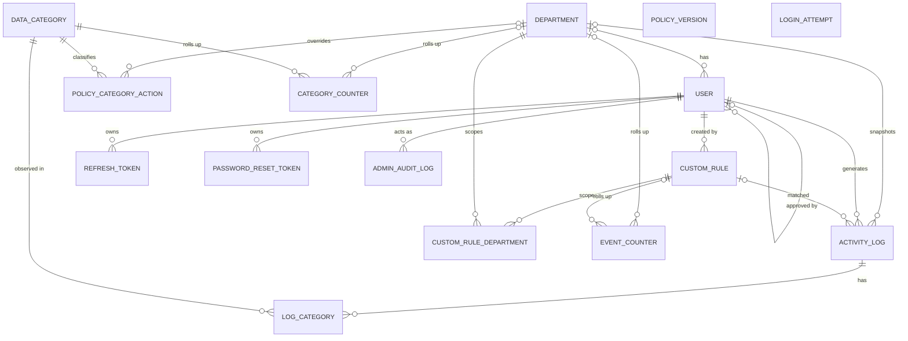

# Data Model (built incrementally)

## L0: Entities and relationships

### Relationships

| Entity A | Entity B | Cardinality | FK Side | Reason (if optional) |
| :--- | :--- | :--- | :--- | :--- |
| Department | User | one-to-many | User (`department_id`) | `department_id` is NULL until approval; a SYSTEM_ADMIN may have no department. |
| User | User (approver) | one-to-many | User (`approved_by`) | Optional: not every account has an approving admin. |
| Department | ActivityLog | one-to-many | ActivityLog (`department_id`) | It is a nullable snapshot (System Admin events; retained even after deactivation). |
| User | ActivityLog | one-to-many | ActivityLog (`user_id`) | — |
| User | RefreshToken | one-to-many | RefreshToken (`user_id`) | — |
| User | PasswordResetToken | one-to-many | PasswordResetToken (`user_id`) | — |
| User | AdminAuditLog (acting admin) | one-to-many | AdminAuditLog (`acting_admin_id`) | — (required; target is polymorphic, so it has no FK) |
| Department | PolicyCategoryAction | one-to-many | PolicyCategoryAction (`department_id`) | NULL rows represent the org default; a department override only exists when set. |
| DataCategory | PolicyCategoryAction | one-to-many | PolicyCategoryAction (`category_code`) | — |
| User | CustomRule (creator) | one-to-many | CustomRule (`created_by`) | — |
| CustomRule | Department | many-to-many | CustomRuleDepartment (both FKs) | Realized by the join entity. |
| ActivityLog | DataCategory | many-to-many | LogCategory (both FKs) | Realized by the join entity. |
| CustomRule | ActivityLog | one-to-many | ActivityLog (`rule_id`) | `rule_id` is NULL when no rule matched / not rule-based. |
| Department | EventCounter | one-to-many | EventCounter (`department_id`) | NULL covers System Admin events / org-wide rollups. |
| CustomRule | EventCounter | one-to-many | EventCounter (`rule_id`) | NULL when no rule matched. |
| Department | CategoryCounter | one-to-many | CategoryCounter (`department_id`) | NULL covers org-wide rollups. |
| DataCategory | CategoryCounter | one-to-many | CategoryCounter (`category_code`) | — |

### Diagram

Notes:
- LoginAttempt is standalone (keyed by account email or source address).
- PolicyVersion is a single counter row, no relationships. The policy bundle is built from the current rows.
- AdminAuditLog target is polymorphic (target_type and target_id), no foreign key for the target.

## L1: Columns, types and nullability

### Enums (all, once)

| Enum (PG type) | Values |
|---|---|
| `user_status` | `PENDING`, `ACTIVE`, `REJECTED`, `DEACTIVATED` |
| `role` | `SYSTEM_ADMIN`, `DEPARTMENT_ADMIN`, `USER` |
| `rule_kind` | `PATTERN`, `KEYWORD`, `TOPIC` |
| `risk_level` | `HIGH`, `MEDIUM`, `LOW`, `NONE` |
| `log_action` | `BLOCKED`, `WARNED`, `ALLOWED` |
| `classification_source` | `LOCAL`, `LOCAL_AI`, `LOCAL_ONLY_FALLBACK` |
| `user_decision` | `NONE`, `SUBMITTED_ANYWAY`, `EDITED`, `REVISION_USED`, `CANCELLED` |
| `policy_action` | `ALLOW`, `WARN`, `BLOCK` |
| `platform` | `CHATGPT`, `GEMINI`, `CLAUDE` |
| `rule_scope` | `ORG_WIDE`, `DEPARTMENTS` |
| `audit_action_type` | `USER_APPROVED`, `USER_REJECTED`, `USER_REOPENED`, `USER_DEACTIVATED`, `USER_REACTIVATED`, `USER_ROLE_CHANGED`, `USER_DEPARTMENT_CHANGED`, `SYSTEM_ADMIN_GRANTED`, `SYSTEM_ADMIN_REVOKED`, `DEPARTMENT_CREATED`, `DEPARTMENT_RENAMED`, `DEPARTMENT_DEACTIVATED`, `POLICY_CHANGED`, `RULE_CHANGED` |
| `target_type` | `USER`, `DEPARTMENT`, `CUSTOM_RULE`, `POLICY` |
| `key_type` | `ACCOUNT`, `SOURCE` |

### 1. Department

| Column | Type | Nullable | Default | Note |
|---|---|---|---|---|
| `id` | `uuid` | no | — | PK (D#18/#23). |
| `name` | `text` | no | — | Unique; deferred (D#18/#23). |
| `active` | `boolean` | no | `true` | `active/status` (D#18/#23). |

### 2. User

| Column | Type | Nullable | Default | Note |
|---|---|---|---|---|
| `id` | `uuid` | no | — | PK (D#3). |
| `full_name` | `text` | no | — | Full name (D#3). |
| `email` | `text` | no | — | Unique; deferred (D#3). |
| `password_hash` | `text` | no | — | One-way hash (WEB-NFR-004). |
| `role` | `role` | yes | — | Null until approval (D#3). |
| `department_id` | `uuid` (FK → Department) | yes | — | Null until approval (D#3). |
| `approved_by` | `uuid` (FK → User) | yes | — | Approving admin; optional. |
| `status` | `user_status` | no | `PENDING` | Defaults to PENDING (D#3). |
| `token_version` | `integer` | no | `0` | Revocation counter (D#12). |
| `registered_at` | `timestamptz` | no | — | Registration (D#3). |
| `approved_at` | `timestamptz` | yes | — | Approval (D#3). |

### 3. DataCategory

| Column | Type | Nullable | Default | Note |
|---|---|---|---|---|
| `category_code` | `text` | no | — | PK; stable UPPER_SNAKE (decision 2). |
| `name` | `text` | no | — | Name (SPEC §7). |
| `default_risk_level` | `risk_level` | no | — | Default risk (SPEC §7). |

### 4. PolicyVersion

| Column | Type | Nullable | Default | Note |
|---|---|---|---|---|
| `id` | `smallint` | no | — | PRIMARY KEY CHECK (id = 1). |
| `version` | `integer` | no | `1` | Global incremental; ETag source (D#5/#6/#7). |

### 5. PolicyCategoryAction

| Column | Type | Nullable | Default | Note |
|---|---|---|---|---|
| `id` | `uuid` | no | — | PK; surrogate. |
| `department_id` | `uuid` (FK → Department) | yes | — | NULL = org default (D#6). |
| `category_code` | `text` (FK → DataCategory) | no | — | Per category (D#6). |
| `action` | `policy_action` | no | — | ALLOW/WARN/BLOCK (D#6). |
| `enabled` | `boolean` | no | `true` | Enabled flag (D#6). |

### 6. CustomRule

| Column | Type | Nullable | Default | Note |
|---|---|---|---|---|
| `id` | `uuid` | no | — | PK (D#5). |
| `created_by` | `uuid` (FK → User) | no | — | Creator. |
| `kind` | `rule_kind` | no | — | PATTERN/KEYWORD/TOPIC (D#5). |
| `name` | `text` | no | — | Name (D#5). |
| `definition` | `text` | no | — | PATTERN ≤512 & ReDoS; TOPIC free text; KEYWORD one per line (D#5). |
| `risk_level` | `risk_level` | no | — | Risk level (D#5). |
| `action` | `policy_action` | no | — | ALLOW/WARN/BLOCK (D#5). |
| `scope` | `rule_scope` | no | — | ORG_WIDE/DEPARTMENTS (D#5). |
| `enabled` | `boolean` | no | `true` | Enabled flag (D#5). |

### 7. CustomRuleDepartment

| Column | Type | Nullable | Default | Note |
|---|---|---|---|---|
| `custom_rule_id` | `uuid` (FK → CustomRule) | no | — | Composite PK part (D#5). |
| `department_id` | `uuid` (FK → Department) | no | — | Composite PK part (D#5). |

*PK = `(custom_rule_id, department_id)`.*

### 8. ActivityLog

| Column | Type | Nullable | Default | Note |
|---|---|---|---|---|
| `log_id` | `uuid` | no | — | PK; unique index (D#2/#8/#21). |
| `user_id` | `uuid` (FK → User) | no | — | From token (D#2). |
| `department_id` | `uuid` (FK → Department) | yes | — | Snapshot; null for System Admin (D#2). |
| `platform` | `platform` | no | — | Platform (SPEC §6). |
| `risk_level` | `risk_level` | no | — | Risk level (SPEC §6). |
| `action` | `log_action` | no | — | BLOCKED/WARNED/ALLOWED (SPEC §6). |
| `classification_source` | `classification_source` | no | — | Source (SPEC §6). |
| `user_decision` | `user_decision` | no | — | Decision (SPEC §6; D#21). |
| `rule_id` | `uuid` (FK → CustomRule) | yes | — | Null when no rule (ARCH §5). |
| `schema_version` | `integer` | no | — | Starts at 1 (decision 5). |
| `event_time` | `timestamptz` | no | — | Event time (SPEC §6). |
| `received_at` | `timestamptz` | no | — | Received time (SPEC §6). |

### 9. LogCategory

| Column | Type | Nullable | Default | Note |
|---|---|---|---|---|
| `log_id` | `uuid` (FK → ActivityLog) | no | — | Composite PK part; many per log (DECISIONS; SPEC §6). |
| `category_code` | `text` (FK → DataCategory) | no | — | Composite PK part (DECISIONS; SPEC §6). |

*PK = `(log_id, category_code)`.*

### 10. EventCounter

| Column | Type | Nullable | Default | Note |
|---|---|---|---|---|
| `id` | `uuid` | no | — | Surrogate PK (nullable keys). |
| `day` | `date` | no | — | Day in UTC (ARCH §5; D#25). |
| `department_id` | `uuid` (FK → Department) | yes | — | NULL = System Admin / org-wide (ARCH §5; D#25). |
| `platform` | `platform` | no | — | Platform (ARCH §5). |
| `risk_level` | `risk_level` | no | — | Risk level (ARCH §5). |
| `action` | `log_action` | no | — | Rolls up log action (DECISIONS). |
| `user_decision` | `user_decision` | no | — | Decision (SPEC §6; D#21). |
| `rule_id` | `uuid` (FK → CustomRule) | yes | — | NULL when no rule (ARCH §5). |
| `event_count` | `bigint` | no | `0` | Count (ARCH §5). |

*Totals only; no user identity; key uniqueness via `NULLS NOT DISTINCT` deferred (L2).*

### 11. CategoryCounter

| Column | Type | Nullable | Default | Note |
|---|---|---|---|---|
| `id` | `uuid` | no | — | Surrogate PK (nullable keys). |
| `day` | `date` | no | — | Day in UTC (ARCH §5). |
| `department_id` | `uuid` (FK → Department) | yes | — | NULL = org-wide (ARCH §5). |
| `platform` | `platform` | no | — | Platform (ARCH §5). |
| `category_code` | `text` (FK → DataCategory) | no | — | Per-category (ARCH §5). |
| `risk_level` | `risk_level` | no | — | Risk level (ARCH §5). |
| `event_count` | `bigint` | no | `0` | Count (ARCH §5). |

*Same as EventCounter; uniqueness via `NULLS NOT DISTINCT` deferred (L2).*

### 12. AdminAuditLog

| Column | Type | Nullable | Default | Note |
|---|---|---|---|---|
| `id` | `uuid` | no | — | PK; surrogate. |
| `acting_admin_id` | `uuid` (FK → User) | no | — | Acting admin (D#11/#19). |
| `action_type` | `audit_action_type` | no | — | Admin action (D#11/#19). |
| `target_type` | `target_type` | no | — | Polymorphic target kind (D#11/#19). |
| `target_id` | `uuid` | yes | — | Polymorphic; POLICY = dept id, NULL = org default (D#11/#19). |
| `created_at` | `timestamptz` | no | `now()` | Timestamp (D#11/#19). |
| `detail` | `jsonb` | yes | — | Before/after; never prompt text (D#11/#19). |

*Append-only; no update/delete; never purged.*

### 13. RefreshToken

| Column | Type | Nullable | Default | Note |
|---|---|---|---|---|
| `id` | `uuid` | no | — | PK; surrogate. |
| `user_id` | `uuid` (FK → User) | no | — | Owner (D#12/#30). |
| `token_hash` | `text` | no | — | Hashed; never plaintext (D#12/#30). |
| `family_id` | `uuid` | no | — | Family; reuse revokes family (D#12/#30). |
| `used` | `boolean` | no | `false` | Used flag; rotated (D#12/#30). |
| `token_version` | `integer` | no | — | Carries token_version (D#12/#30). |
| `expires_at` | `timestamptz` | no | — | Expiry (D#12/#30). |
| `revoked_at` | `timestamptz` | yes | — | Set when the family is revoked (reuse detected, logout, deactivation) (D#12/#30). |
| `created_at` | `timestamptz` | no | now() | — |

### 14. PasswordResetToken

| Column | Type | Nullable | Default | Note |
|---|---|---|---|---|
| `id` | `uuid` | no | — | PK; surrogate. |
| `user_id` | `uuid` (FK → User) | no | — | Owner (D#15). |
| `token_hash` | `text` | no | — | Hashed; never plaintext (D#15). |
| `used` | `boolean` | no | `false` | Single-use (D#15). |
| `expires_at` | `timestamptz` | no | — | 30-minute expiry (D#15). |
| `created_at` | `timestamptz` | no | now() | — |

### 15. LoginAttempt

| Column | Type | Nullable | Default | Note |
|---|---|---|---|---|
| `key` | `text` | no | — | Composite PK part; hash of normalized email/address. |
| `key_type` | `key_type` | no | — | Composite PK part; ACCOUNT/SOURCE (D#22). |
| `failure_count` | `integer` | no | `0` | Failure counter; progressive delay (D#22). |
| `window_start` | `timestamptz` | no | — | Window start; 5-in-15 rule (D#22). |
| `next_allowed_at` | `timestamptz` | yes | — | Next allowed; NULL when none (D#22). |

*PK = `(key, key_type)`; standalone (no user FK); survives restarts; no hard lockout.*

## L2: Constraints and integrity rules

### 1. UNIQUE

| Constraint | Definition | Prisma? |
|---|---|---|
| User.email (case-insensitive) | `CREATE UNIQUE INDEX uq_user_email_lower ON "User" (lower(email));` | Raw SQL |
| Department.name (case-insensitive) | `CREATE UNIQUE INDEX uq_department_name_lower ON "Department" (lower(name));` | Raw SQL |
| PolicyCategoryAction `(department_id, category_code)` | `CREATE UNIQUE INDEX ... ON "PolicyCategoryAction" (department_id, category_code) NULLS NOT DISTINCT;` | Raw SQL |
| EventCounter all key columns | `(day, department_id, platform, risk_level, action, user_decision, rule_id) NULLS NOT DISTINCT` | Raw SQL |
| CategoryCounter all key columns | `(day, department_id, platform, category_code, risk_level) NULLS NOT DISTINCT` | Raw SQL |
| RefreshToken.token_hash | `@unique` | Plain DDL |
| PasswordResetToken.token_hash | `@unique` | Plain DDL |
| LoginAttempt `(key_type, key)` | covered by PK (no extra index) | Plain DDL |

### 2. CHECK (all Raw SQL — Prisma has no CHECK)

| Table | CHECK |
|---|---|
| User | `CHK_User_status_role`: `((status IN ('PENDING','REJECTED') AND role IS NULL AND department_id IS NULL) OR (status IN ('ACTIVE','DEACTIVATED') AND role IS NOT NULL))` |
| User | `CHK_User_role_department`: `(role IS NULL OR role = 'SYSTEM_ADMIN' OR department_id IS NOT NULL)` |
| EventCounter | `event_count >= 0` |
| CategoryCounter | `event_count >= 0` |
| ActivityLog | `schema_version >= 1` |
| PolicyVersion | `version >= 1`; single row via `id smallint PRIMARY KEY CHECK (id = 1)` |
| CustomRule | `(kind <> 'PATTERN' OR char_length(definition) <= 512)` |
| AdminAuditLog | `(target_type = 'POLICY' OR target_id IS NOT NULL)` |
| RefreshToken | `expires_at > created_at` |
| PasswordResetToken | `expires_at > created_at` |
| CustomRule | `(kind = 'PATTERN' OR char_length(definition) <= 4000)` |
| CustomRule | `char_length(definition) >= 1` |

### 3. CustomRule scope rule

| Rule | Enforcement | Prisma? |
|---|---|---|
| `DEPARTMENTS` requires ≥1 CustomRuleDepartment; `ORG_WIDE` requires none | **Deferred constraint trigger** (raw SQL): after INSERT/UPDATE on CustomRule and after INSERT/UPDATE/DELETE on CustomRuleDepartment, raises if violated; `DEFERRABLE INITIALLY DEFERRED`. App-level as fallback. | Raw SQL |

### 4. FOREIGN KEY delete behavior

Users, departments, categories and rules are **never deleted** (only deactivated/disabled) → `RESTRICT`; ActivityLog purge cascades to LogCategory → `CASCADE`.

| FK | ON DELETE | Prisma? |
|---|---|---|
| User.department_id → Department | RESTRICT | Plain |
| User.approved_by → User | RESTRICT | Plain |
| PolicyCategoryAction.department_id → Department | RESTRICT | Plain |
| PolicyCategoryAction.category_code → DataCategory | RESTRICT | Plain |
| CustomRule.created_by → User | RESTRICT | Plain |
| CustomRuleDepartment.custom_rule_id → CustomRule | RESTRICT | Plain |
| CustomRuleDepartment.department_id → Department | RESTRICT | Plain |
| ActivityLog.user_id → User | RESTRICT | Plain |
| ActivityLog.department_id → Department | RESTRICT | Plain |
| ActivityLog.rule_id → CustomRule | RESTRICT | Plain |
| LogCategory.log_id → ActivityLog | **CASCADE** (purge) | Plain |
| LogCategory.category_code → DataCategory | RESTRICT | Plain |
| EventCounter.department_id → Department | RESTRICT | Plain |
| EventCounter.rule_id → CustomRule | RESTRICT | Plain |
| CategoryCounter.department_id → Department | RESTRICT | Plain |
| CategoryCounter.category_code → DataCategory | RESTRICT | Plain |
| AdminAuditLog.acting_admin_id → User | RESTRICT | Plain |
| RefreshToken.user_id → User | RESTRICT | Plain |
| PasswordResetToken.user_id → User | RESTRICT | Plain |

### 5. TRIGGERS

| Table | Trigger | Prisma? |
|---|---|---|
| AdminAuditLog | `BEFORE UPDATE` + `BEFORE DELETE` → raise (append-only; no mutate/purge) | Raw SQL |
| ActivityLog | `BEFORE UPDATE` → raise; **do NOT** block DELETE (purge is allowed). Recommend blocking UPDATE since rows are immutable after insert. | Raw SQL |
| AdminAuditLog | `BEFORE TRUNCATE` (statement-level) → raise. Also `REVOKE UPDATE, DELETE, TRUNCATE ON "AdminAuditLog" FROM <app_role>` so the application's database role cannot mutate it even if a trigger is dropped. | Raw SQL |