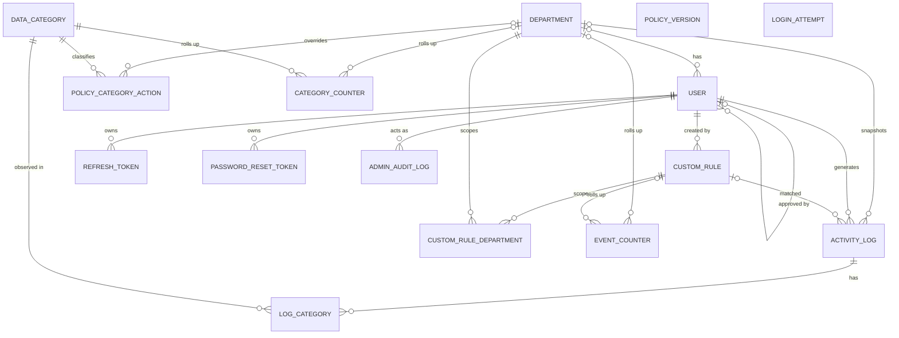

# Data Model (built incrementally)

## L0: Entities and relationships

### Relationships

| Entity A | Entity B | Cardinality | FK Side | Reason (if optional) |
| :--- | :--- | :--- | :--- | :--- |
| Department | User | one-to-many | User (`department_id`) | `department_id` is NULL until approval; a SYSTEM_ADMIN may have no department. |
| User | User (approver) | one-to-many | User (`approved_by`) | Optional: not every account has an approving admin. |
| Department | ActivityLog | one-to-many | ActivityLog (`department_id`) | It is a nullable snapshot (System Admin events; retained even after deactivation). |
| User | ActivityLog | one-to-many | ActivityLog (`user_id`) | — |
| User | RefreshToken | one-to-many | RefreshToken (`user_id`) | — |
| User | PasswordResetToken | one-to-many | PasswordResetToken (`user_id`) | — |
| User | AdminAuditLog (acting admin) | one-to-many | AdminAuditLog (`acting_admin_id`) | — (required; target is polymorphic, so it has no FK) |
| Department | PolicyCategoryAction | one-to-many | PolicyCategoryAction (`department_id`) | NULL rows represent the org default; a department override only exists when set. |
| DataCategory | PolicyCategoryAction | one-to-many | PolicyCategoryAction (`category_code`) | — |
| User | CustomRule (creator) | one-to-many | CustomRule (`created_by`) | — |
| CustomRule | Department | many-to-many | CustomRuleDepartment (both FKs) | Realized by the join entity. |
| ActivityLog | DataCategory | many-to-many | LogCategory (both FKs) | Realized by the join entity. |
| CustomRule | ActivityLog | one-to-many | ActivityLog (`rule_id`) | `rule_id` is NULL when no rule matched / not rule-based. |
| Department | EventCounter | one-to-many | EventCounter (`department_id`) | NULL covers System Admin events / org-wide rollups. |
| CustomRule | EventCounter | one-to-many | EventCounter (`rule_id`) | NULL when no rule matched. |
| Department | CategoryCounter | one-to-many | CategoryCounter (`department_id`) | NULL covers org-wide rollups. |
| DataCategory | CategoryCounter | one-to-many | CategoryCounter (`category_code`) | — |

### Entities

Notes:
- LoginAttempt is standalone (keyed by account email or source address).
- PolicyVersion is a single counter row, no relationships. The policy bundle is built from the current rows.
- AdminAuditLog target is polymorphic (target_type and target_id), no foreign key for the target.